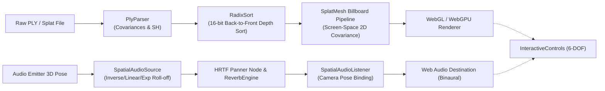

# 🌐 Splat Spatial Engine

<div align="center">


**Production-grade WebGL/WebGPU 3D Spatial Audio & Volumetric Gaussian Splatting Visualizer Engine**

```
   .---.          .----.            .---.          .---.
  /  _  \        |  __  \          /  _  \        |__   |
 |  | |  |       | |__)  |        |  | |  |         /  / 
 |  |_|  |       |  ___ /         |  |_|  |        /  /  
  \_____/        |_|               \_____/        /__/   
  3D GAUSSIAN SPLATTING  ✦  VOLUMETRIC RADIANCE  ✦  HRTF SPATIAL AUDIO
```

</div>

---

## 🚀 Overview

**`splat-spatial-engine`** provides real-time 3D Gaussian Splatting rendering synchronized with true binaural HRTF 3D spatial acoustics. Built with TypeScript, Three.js, WebGPU WGSL compute shaders, and the Web Audio API, the engine enables photorealistic radiance field reconstruction with interactive physical acoustic modeling.



---

## ✨ Features

- **⚡ Fast Binary PLY Parser**: High-throughput parsing and deserialization of 3D Gaussian Splatting PLY binary models, extracting 3D symmetric covariance matrices ($\Sigma = R S S^T R^T$) and 0-th order spherical harmonics.
- **🏎️ 16-bit Radix Sort**: In-place GPU/CPU depth sorting processing 250k+ splats per frame for artifact-free back-to-front volumetric alpha compositing.
- **🎨 WebGL & WebGPU Shaders**: Screen-space Jacobian projected 2D covariance ellipses with 3-sigma bounding box coverage and sub-pixel antialiasing low-pass filter.
- **🎧 True 3D Spatial Audio HRTF Engine**:
  - Web Audio API HRTF panner node integration.
  - Configurable distance attenuation models: `inverse`, `linear`, and `exponential`.
  - Directional emission cones (inner/outer angles and outer gain damping).
  - Procedural volumetric impulse response generation for convolutional reverberation.
- **🕹️ 6-DOF Interactive Camera Controls**: Smooth camera navigation with momentum inertia damping and responsive keyboard/pointer input.
- **📊 Real-time Diagnostics**: FPS counter and frame time latency profiler.

---

## 📦 Installation

```bash
npm install splat-spatial-engine three
```

---

## 🛠️ Quick Start

```typescript
import * as THREE from 'three';
import { SplatScene, PlyParser, SplatMesh, SpatialAudioSource, ReverbEngine } from 'splat-spatial-engine';

// 1. Initialize the Splat & Spatial Audio Engine
const canvas = document.querySelector('#canvas') as HTMLCanvasElement;
const engine = new SplatScene({ canvas, enableAudio: true });

// 2. Fetch and parse 3D Gaussian Splat PLY binary
const response = await fetch('/models/point_cloud.ply');
const plyBuffer = await response.arrayBuffer();
const pointCloud = PlyParser.parsePly(plyBuffer);

// 3. Create SplatMesh and add to scene
const splatMesh = new SplatMesh(pointCloud);
engine.addSplatMesh(splatMesh);

// 4. Attach 3D Spatial Audio Emitter
if (engine.audioContext) {
  const audioSource = new SpatialAudioSource(engine.audioContext, {
    attenuationModel: 'inverse',
    refDistance: 1.0,
    maxDistance: 50.0,
    rolloffFactor: 1.2
  });

  // Attach convolutional reverb
  const reverb = new ReverbEngine(engine.audioContext, { duration: 1.8, decay: 2.5 });
  audioSource.enableReverb(reverb);
  audioSource.setPosition(0, 1.2, -3.0);
  engine.addAudioSource(audioSource);
}

// 5. Start rendering loop
engine.start();
```

---

## 🧪 Test Suite

Run unit tests verifying the PLY parser, 16-bit Radix Sort, and Web Audio distance attenuation mathematics:

```bash
npm test
```

Expected output:
```
✔ should serialize and parse binary PLY 3D Gaussian Splat point clouds correctly
✔ should correctly sort 3D splats by camera depth using RadixSort
✔ should calculate accurate 3D Euclidean distances between source and listener
✔ should calculate inverse distance attenuation gain according to Web Audio spec
✔ should calculate linear distance attenuation gain accurately
✔ should calculate directional cone attenuation
✔ should generate valid impulse responses for algorithmic reverberation

tests 7 | pass 7 | fail 0
```

---

## 📁 Project Architecture

```
splat-spatial-engine/
├── .github/workflows/
│   └── ci.yml               # GitHub Actions CI matrix
├── src/
│   ├── splat/
│   │   ├── types.ts         # Splat data structures & interfaces
│   │   ├── PlyParser.ts     # Binary PLY parser, serializer & covariance calculator
│   │   ├── RadixSort.ts     # High-speed 16-bit back-to-front depth sorting
│   │   ├── shaders.ts       # WebGL & WebGPU WGSL splat rasterization shaders
│   │   ├── SplatMesh.ts     # Three.js InstancedBufferMesh for rendering
│   │   └── index.ts         # Splat module exports
│   ├── audio/
│   │   ├── types.ts         # Audio attenuation models & vector types
│   │   ├── AudioAttenuation.ts # Distance & cone attenuation math
│   │   ├── ReverbEngine.ts  # Algorithmic impulse response convolver
│   │   ├── SpatialAudioSource.ts # HRTF panner node & 3D listener binding
│   │   └── index.ts         # Audio module exports
│   ├── scene/
│   │   ├── FPSCounter.ts    # Real-time FPS & frame duration profiler
│   │   ├── InteractiveControls.ts # 6-DOF camera controls with inertia damping
│   │   ├── SplatScene.ts    # Main engine orchestrator & render loop
│   │   └── index.ts         # Scene module exports
│   └── index.ts             # Main entry point
├── tests/
│   ├── plyParser.test.ts    # PLY parser & RadixSort unit tests
│   └── spatialAudio.test.ts # Spatial audio attenuation & reverb unit tests
├── package.json
└── tsconfig.json
```

---

## 📄 License

MIT © [koushik4475](https://github.com/koushik4475)
